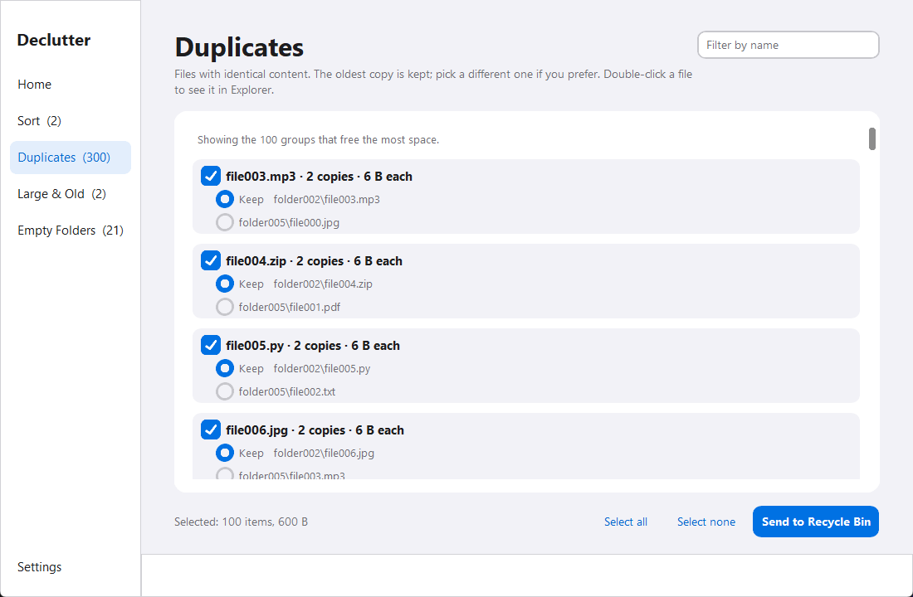
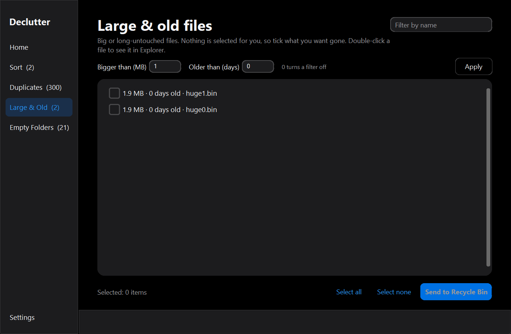

# Declutter

A modern, transparent Windows desktop utility that tidies messy folders safely. It previews every action visually, routes all removals to the native Windows Recycle Bin, and provides instant 1-click undo for file sorting.

[](https://github.com/w1tneess/declutter/actions/workflows/ci.yml)
[](https://github.com/w1tneess/declutter/releases/latest)
[](LICENSE)
[](https://github.com/w1tneess/declutter)
[](#safety-by-design)

---

## Screenshots

<p align="center">
  
  
</p>

---

## Quick Install

Download the latest release from [GitHub Releases](https://github.com/w1tneess/declutter/releases/latest):

| Format | Download | Description |
|---|---|---|
| **Windows Installer** | [`Declutter-Setup.exe`](https://github.com/w1tneess/declutter/releases/latest) | Recommended. Standard Inno Setup installer. Installs strictly for your user account without requiring administrator rights or UAC prompts. Creates Start Menu entries and an uninstaller. |
| **Portable Package** | [`Declutter-portable.zip`](https://github.com/w1tneess/declutter/releases/latest) | Standalone package. Extract anywhere (including USB drives or external disks) and run `Declutter.exe` with zero installation or registry modification. |

> [!NOTE]
> **Windows SmartScreen Note:**  
> Declutter is an open-source project and does not use expensive annual commercial code-signing certificates. On the first launch, Windows SmartScreen may display *"Windows protected your PC"* (Unknown publisher). Click **More info**, then click **Run anyway**. All binaries are built openly and transparently via public GitHub Actions runners.

Uninstall anytime from **Windows Settings > Apps > Installed apps**.

---

## What It Does

Declutter runs four concurrent analysis engines across any folder you select:

### 1. Sort by Type
* Organizes loose top-level files into dedicated category directories:
  * **Images/** (`.jpg`, `.jpeg`, `.png`, `.gif`, `.bmp`, `.webp`, `.svg`, `.heic`, `.tiff`, `.ico`)
  * **Documents/** (`.pdf`, `.doc`, `.docx`, `.txt`, `.rtf`, `.odt`, `.md`, `.ppt`, `.pptx`, `.xls`, `.xlsx`, `.csv`)
  * **Videos/** (`.mp4`, `.mkv`, `.avi`, `.mov`, `.wmv`, `.flv`, `.webm`)
  * **Audio/** (`.mp3`, `.wav`, `.flac`, `.aac`, `.ogg`, `.m4a`)
  * **Archives/** (`.zip`, `.rar`, `.7z`, `.tar`, `.gz`, `.bz2`)
  * **Installers/** (`.exe`, `.msi`, `.bat`, `.cmd`, `.ps1`)
  * **Code & Data/** (`.py`, `.js`, `.jsx`, `.ts`, `.tsx`, `.json`, `.yaml`, `.yml`, `.html`, `.css`)
  * **Other Files/** (Any unclassified extensions are safely routed here without data loss)
* **Non-Destructive Collision Handling:** If `photo.jpg` already exists in `Images/`, the new file automatically becomes `photo (1).jpg`. Files are never overwritten.
* **Instant 1-Click Undo:** Reverts all moved files back to their exact original locations and cleans up empty category folders.

### 2. Duplicate Detection
* Compares actual file content, never just file names.
* Three-tier verification: exact byte size match, 64 KB partial content hash match, then full **cryptographic SHA-256** hash calculation.
* **Protected Keeper:** The oldest-modified copy is automatically marked as the protected keeper and cannot be accidentally deleted. Users can easily reassign the keeper per group.
* **Invariant Guard:** A duplicate group can never have all of its copies selected for deletion.

### 3. Large & Inactive Radar
* Dual-slider threshold radar: filters by minimum size (MB) and inactivity age (days untouched).
* Quickly identifies abandoned disk images, virtual machines, giant video renders, and old installers devouring storage space.
* Sorted by file size, largest first.

### 4. Deep Empty Folder Pruner
* Recursively detects abandoned folder trees at any depth.
* Ignores benign Windows metadata files (`desktop.ini`, `Thumbs.db`).
* Prunes strictly from the deepest branch upward, leaving parent directories intact if other content resides within.

### 5. Desktop Ergonomics
* **Live Name Filtering:** Quick search filter on each list. Only rows currently visible count as selected, ensuring hidden items are never modified.
* **Explorer Reveal:** Double-click any file or folder row to highlight it directly in Windows File Explorer (files are never executed or opened).
* **Theme Options:** Follows Windows System theme automatically, or can be manually set to Dark or Light mode.
* **Persistent Settings:** Remembers theme preferences, last-opened folder, and custom size/age radar thresholds.

---

## Safety by Design

Declutter is engineered with hardcoded safeguards to eliminate the risk of accidental file loss:

* **100% Recycle Bin Guarantee:** All deletions route through the native Windows Recycle Bin using `send2trash` on local fixed drives. Declutter never permanently deletes (`Shift+Delete`) your files.
* **Atomic Rollback Journal:** Sort operations are logged to `%LOCALAPPDATA%\Declutter\undo.json` using atomic file replacement. Clicking *"Undo last sort"* safely returns every file to its prior path.
* **Protected System Roots:** Declutter strictly refuses drive roots (`C:\`, `D:\`), user home directories (`C:\Users\<Name>`), Windows system directories, `Program Files`, `ProgramData`, and `AppData`.
* **Developer Project Shield:** Automatically detects and skips code projects (directories containing `.git`, `node_modules`, `.venv`, `package.json`, or `.sln`).
* **Cloud-Only Placeholder Guard:** Detects OneDrive and Dropbox online-only placeholder files (NTFS `FILE_ATTRIBUTE_OFFLINE`, `RECALL_ON_OPEN`) and skips them so no bandwidth-heavy downloads are triggered.
* **Active Downloads Guard:** Ignores partial downloads (`.crdownload`, `.part`, `.tmp`, `.download`, `.opdownload`, `.!qB`) and files modified within the last 5 minutes.
* **Junction & Symlink Isolation:** Refuses directory junctions and symlinks to prevent circular scanning and directory traversal loops.
* **Stale-Scan Verification:** Immediately before executing any move or recycle operation, Declutter re-checks file existence and state on disk. If a file is locked or changed, it is safely skipped and reported without breaking the remaining batch.
* **100% Offline & Private:** Declutter never makes an internet connection, sends telemetry, or tracks usage. Everything executes strictly on your local computer.

---

## Run from Source

### Prerequisites
* Windows 10 or 11 (64-bit)
* Python 3.12+

```powershell
# Clone the repository
git clone https://github.com/w1tneess/declutter.git
cd declutter

# Install runtime dependencies
python -m pip install -r requirements.txt

# Run Declutter
cd src
python -m declutter
```

Or from the repository root:
```powershell
python launcher.py
```

---

## Development & Testing

Install development and testing dependencies:
```powershell
python -m pip install -r requirements-dev.txt
```

Run the automated test suite:
```powershell
python -m pytest -q
```

All unit tests run inside isolated temporary directories (`.pytest_tmp/`) and never touch user directories.

---

## Building the Standalone App & Installer

Declutter includes an automated build script (`build.bat`) that compiles the Python source into a standalone folder via PyInstaller and packages an Inno Setup installer:

```cmd
set APP_VERSION=1.0.0
build.bat
```

The build script produces:
1. `dist\Declutter\` – PyInstaller **onedir** distribution.
2. `dist\Declutter-portable.zip` – Standalone portable zip package.
3. `dist\Declutter-Setup.exe` – Per-user Inno Setup Windows installer (if [Inno Setup 6](https://jrsoftware.org/isinfo.php) is installed).

All releases are also compiled and packaged automatically in the cloud on Windows runners via GitHub Actions ([`.github/workflows/release.yml`](.github/workflows/release.yml)).

---

## Repository Layout

```
declutter/
├── .github/
│   └── workflows/
│       ├── ci.yml               # Automated test runner on push / PR
│       ├── deploy-website.yml   # Web deployment workflow
│       └── release.yml          # Automated PyInstaller & Inno Setup release builds
├── assets/
│   ├── icon.ico                 # Application icon
│   ├── screenshot-dark.png      # Application screenshot (dark theme)
│   └── screenshot-duplicates.png# Application screenshot (duplicates)
├── installer/
│   └── declutter.iss            # Inno Setup installer script
├── src/
│   └── declutter/
│       ├── __init__.py          # Package initializer
│       ├── __main__.py          # Entrypoint (python -m declutter)
│       ├── app.py               # CustomTkinter GUI & async thread runner
│       ├── core.py              # Pure Python business logic & safety engine
│       └── theme.py             # Color palette tokens & appearance definitions
├── tests/
│   └── test_core.py             # Pytest unit tests for core scanning & operations
├── website/                     # React + Vite product website & interactive simulator
├── build.bat                    # Local Windows packaging script
├── launcher.py                  # Root execution launcher
├── requirements.txt             # Runtime requirements (customtkinter, send2trash)
├── requirements-dev.txt         # Dev dependencies (pytest, pyinstaller)
├── SPEC.md                      # Technical specification & working rules
├── DESIGN.md                    # Visual design tokens & HIG guidelines
├── CLAUDE.md                    # Developer guidelines
└── LICENSE                      # MIT License
```

---

## Known Limitations

* **Code Signing:** The binary is unsigned, meaning Windows SmartScreen will display an "Unknown publisher" warning on the first run.
* **Antivirus False Positives:** PyInstaller executable packages can occasionally trigger false-positive heuristics in third-party antivirus utilities. Building publicly via GitHub Actions provides full build transparency.
* **Recycle Bin Restoration:** Files sent to the Recycle Bin are restored through Windows Recycle Bin, rather than the app's Sort Undo feature.

---

## License

Released under the [MIT License](LICENSE). Copyright © 2026 w1tneess.
